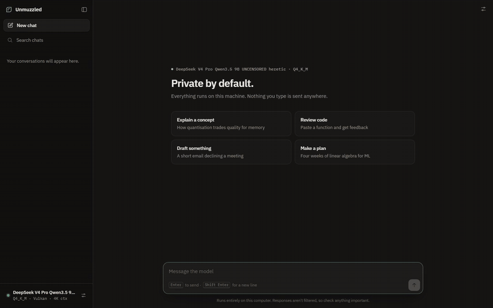
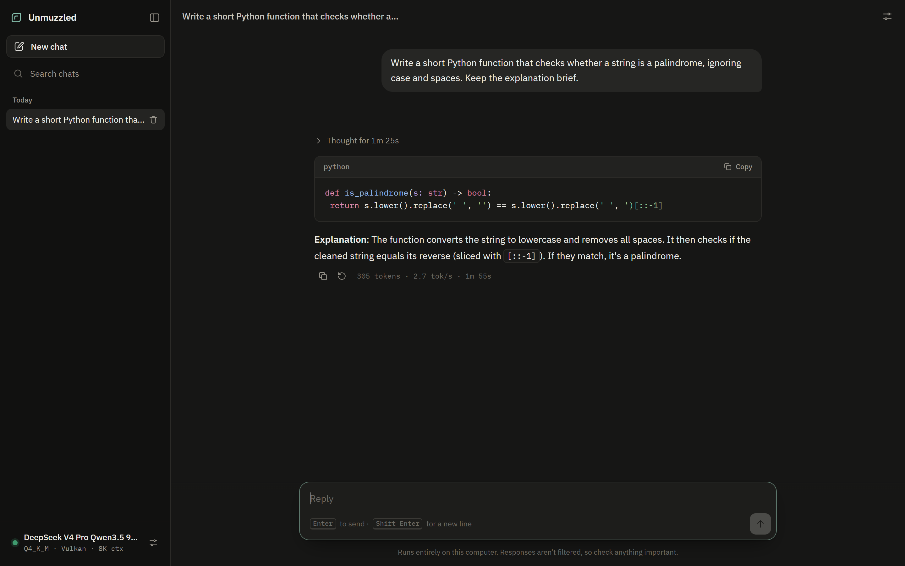
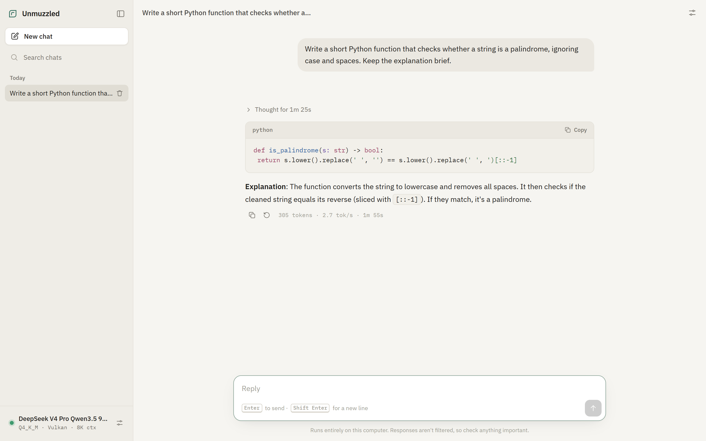

# Unmuzzled

**Private, offline AI chat that runs entirely on your own computer.**
One command opens a clean chat interface in your browser, where you pick an open model to download once. It then runs entirely on your machine. No account, no API key, no cloud.

```bash
npx unmuzzled
```



<sub>A real run on a laptop (Intel Iris Xe). Generation is sped up 8×; the real speed is shown at the end.</sub>



<details>
<summary>Light theme</summary>



</details>

[](LICENSE)


---

## Why

Cloud assistants see every prompt you send, enforce their own content rules, and stop working when you're offline or out of credits. Unmuzzled runs an open-weight model on your own hardware instead. Your conversations stay on your machine, and the model is one you choose.

## Features

- **Fully local inference** through [llama.cpp](https://github.com/ggml-org/llama.cpp) via [node-llama-cpp](https://github.com/withcatai/node-llama-cpp). Uses CUDA, Vulkan or Metal when available and falls back to CPU.
- **Streaming responses** with Markdown, tables and syntax-highlighted code blocks with copy buttons.
- **Reasoning view.** Models that think before answering show their reasoning live in a collapsible, timed panel.
- **Edit and regenerate.** Change an earlier message and continue the conversation from there.
- **Conversation history** with search, rename and undoable delete. Stored only in your browser.
- **Settings** for system prompt, temperature, top‑p and response length; model details at a glance.
- **Light and dark themes**, keyboard shortcuts, and a layout that works down to phone width.
- **Bring your own model.** Point it at any GGUF file or download URL.

## Default model

On first run, Unmuzzled opens a setup screen offering this model (with its size and your machine's RAM and free disk). Nothing downloads until you click **Download**, and you can pause and resume. Pass `--model` to use your own file instead:

| | |
|---|---|
| **Name** | DeepSeek‑V4‑Pro‑Qwen3.5‑9B‑UNCENSORED‑heretic, Q4_K_M (imatrix) |
| **Size** | 5.63 GB download, about 7 GB of memory while running |
| **Licence** | Apache‑2.0 at every step below |

How it was made:

1. [**Qwen3.5‑9B**](https://huggingface.co/Qwen/Qwen3.5-9B) — base model by the Qwen team.
2. [**Jackrong/DeepSeek‑V4‑Pro‑Qwen3.5‑9B**](https://huggingface.co/Jackrong/DeepSeek-V4-Pro-Qwen3.5-9B) — fine-tuned on ~250k maths and STEM reasoning samples generated by DeepSeek‑V4‑Pro.
3. [**xtools-at/…‑UNCENSORED‑heretic**](https://huggingface.co/xtools-at/DeepSeek-V4-Pro-Qwen3.5-9B-UNCENSORED-heretic) — refusal behaviour removed with [Heretic](https://heretic-project.org) (3/100 refusals vs 100/100 for the original, on the author's test set).
4. [**mradermacher/…‑i1‑GGUF**](https://huggingface.co/mradermacher/DeepSeek-V4-Pro-Qwen3.5-9B-UNCENSORED-heretic-i1-GGUF) — quantised to GGUF.

> **Note:** despite the name, this is **not** DeepSeek's model. It's a 9‑billion‑parameter Qwen model trained to imitate DeepSeek‑V4‑Pro's reasoning style.

Unmuzzled doesn't include or redistribute these weights. They're downloaded directly from Hugging Face under their own licence.

## Responsible use

The default model has had its refusal training removed. It will engage with requests other assistants decline, and like any language model it can be confidently wrong. You are responsible for what you do with it and for complying with the laws that apply to you. Don't rely on it for medical, legal, financial or safety-critical decisions. Unmuzzled is a general-purpose interface. Use `--model` to run any model you prefer, including ones with safety training intact.

## Requirements and performance

- Node.js 20 or newer
- About 8 GB of free memory for the default model (RAM, or VRAM on a dedicated GPU)
- About 6 GB of disk space

Speed depends entirely on your hardware. Measured on a mid-range laptop (Intel i5‑1135G7, Iris Xe graphics via Vulkan, 16 GB RAM): **2–3 tokens/second**, with a 40-second model load. A recent discrete GPU or Apple Silicon Mac is many times faster. If it's slow, close memory-heavy apps, lower `--ctx`, or use a smaller model.

## Usage

```bash
npx unmuzzled                          # open the interface; first run offers to download the default model
npx unmuzzled --model ./my-model.gguf  # use a GGUF file you already have
npx unmuzzled --model https://huggingface.co/<user>/<repo>/resolve/main/<file>.gguf
npx unmuzzled --ctx 4096 --port 5000
```

| Option | Default | |
|---|---|---|
| `-m, --model` | — | Path to a `.gguf` file, or a URL to download one from |
| `-p, --port` | `4317` | Port for the web interface |
| `--host` | `127.0.0.1` | Address to bind. See [Security](#security) before changing this |
| `--ctx` | `8192` | Maximum context size in tokens |
| `--gpu` | `auto` | `auto`, `cuda`, `vulkan`, `metal` or `false` |
| `--no-open` | | Don't open the browser automatically |
| `--mock` | | Run the interface with a fake model, for development |

Downloaded models are stored in `~/.unmuzzled/models`. Once the default model is there, Unmuzzled skips setup and loads it straight away.

### Keyboard shortcuts

| | |
|---|---|
| `Enter` / `Shift+Enter` | Send / new line |
| `Esc` | Stop generating, close settings |
| `Ctrl+Shift+O` | New chat |
| `Ctrl+\` | Toggle sidebar |
| `/` | Focus the message box |
| Double-click the title | Rename the chat |

## Android (beta)

Unmuzzled also runs **entirely on your phone**, using the same model and design, with no laptop or server involved. It needs a 64-bit Android phone with about 12 GB of RAM for the default 9B model. See [`mobile/`](mobile/README.md) for features, install steps and building from source.

## Privacy

- After the model has been downloaded, Unmuzzled makes **no network requests**. Your prompts and responses never leave your computer.
- Unmuzzled has no telemetry, analytics or accounts.
- The interface loads no remote fonts, scripts or images. Model output is rendered with raw HTML escaped, and remote images are never fetched.
- Chats are saved in your browser's local storage. **Settings → Data** lets you export or delete them.

## Security

- The server listens on `127.0.0.1` only, so other devices can't reach it.
- It rejects requests whose `Host` header isn't local (protection against DNS rebinding). It also requires JSON requests, so other websites can't trigger generations through your browser.
- `--host 0.0.0.0` exposes the model to **everyone on your network with no login**. Only use it on networks you trust.

Found a vulnerability? Please open a [private security advisory](https://github.com/rahulagarwal18/unmuzzled/security/advisories/new) rather than a public issue.

## Development

```bash
git clone https://github.com/rahulagarwal18/unmuzzled
cd unmuzzled
npm install
npm run dev -- --mock                    # interface only, no model needed
npm start -- --model path/to/model.gguf
```

There's no build step. The interface is plain HTML, CSS and ES modules, served by a small Node server.

```
bin/unmuzzled.js   CLI: arguments, model download, startup
src/server.js      HTTP server, static files, streaming chat API (SSE)
src/engine.js      node-llama-cpp wrapper, reasoning/answer separation, mock engine
public/            the web interface
```

## Acknowledgements

Unmuzzled stands on a lot of open work:
- [llama.cpp](https://github.com/ggml-org/llama.cpp) and [node-llama-cpp](https://github.com/withcatai/node-llama-cpp), which run the model.
- The model chain credited above: the Qwen team, Jackrong, xtools-at, the Heretic project and mradermacher.
- [marked](https://github.com/markedjs/marked) for Markdown and [highlight.js](https://highlightjs.org) for code highlighting.
- [IBM Plex](https://github.com/IBM/plex) (SIL Open Font License), served from the [Fontsource](https://fontsource.org) packages.

## Disclaimer

Unmuzzled is an independent project. It is not affiliated with or endorsed by DeepSeek, Alibaba Cloud / the Qwen team, Hugging Face, or any of the model authors listed above. All product names and trademarks belong to their respective owners. The software is provided "as is", without warranty of any kind. See [LICENSE](LICENSE).

## License

[MIT](LICENSE) © 2026 Rahul Agarwal
